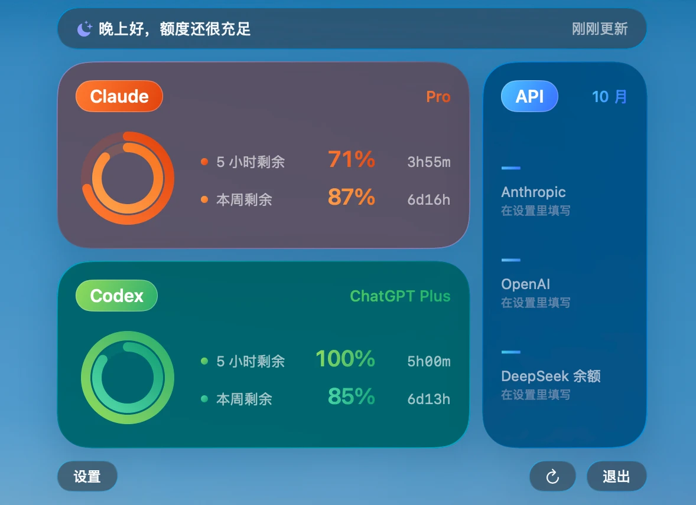

<div align="center">

# AI Usage Menubar

**Your Claude and ChatGPT plan limits, at a glance, in Liquid Glass.**

A native macOS menu bar app that shows how much of your Claude and Codex
quota is left, plus this month's API spend, in a panel inspired by Control Center
and Apple's activity rings.



SwiftUI · macOS 14+ · Liquid Glass on macOS 26 · Universal (Apple Silicon + Intel)

[中文介绍](#中文介绍)

</div>

---

## Design

The whole app is one small panel, so every detail of it was designed rather than defaulted.

- **Liquid Glass, Control Center style.** No backing sheet. Each block is its own piece of
  native `glassEffect` glass, floating over your desktop with only a transparent margin
  around it, so the glass glow fades out instead of being clipped into a hard edge.
- **Activity-style rings.** Concentric rings show what's left of each limit:
  the 5-hour window outside, the weekly limit inside, and Opus when your plan has it.
- **One color family per provider.** Claude is orange, Codex is green, API is blue.
  Within a family the shades run strictly from deep to light, so the outer ring is
  always the strongest.
- **Gradient type, used with restraint.** Percentages and plan names are filled with
  the same gradient as their ring. Labels and captions stay in the system's secondary
  gray, so names, numbers and captions read as one balanced block.
- **Typography that lines up.** SF Pro with tight tracking, tabular figures for
  percentages, and a monospaced, fixed-width countdown (`4h05m`, `5d03h`) so every
  column aligns row to row.
- **The menu bar tells you without opening.** Two tiny colored rings, one per
  provider, each filled by the 5-hour quota you have left, with the percent next to it.
- **Follows the system.** Light and dark mode, Reduce Transparency, and a
  Standard / Clear glass setting.
- **English and Chinese.** The UI follows your system language, or pick one in Settings.
- **A friendly line on top.** A greeting that changes with the time of day and
  with how much quota you have left.

## What it shows

| Block | Data | Where it comes from |
|---|---|---|
| Claude | 5-hour and weekly limits left (and Opus on Max) | Your Claude Code login, or a claude.ai `sessionKey` |
| Codex | 5-hour and weekly limits left | Your Codex login in `~/.codex` (same data as Codex's own status view), with the local session logs as fallback |
| API | Month-to-date spend | Anthropic and OpenAI Admin APIs |
| API | DeepSeek balance | DeepSeek `/user/balance` |

The panel refreshes on a timer you choose (1 to 30 minutes). Claude's usage endpoint
rate-limits hard, so it is polled at most every 4 minutes, backs off when asked to,
and keeps showing the last numbers in the meantime.

## Install

1. Download `AIUsage.zip` from [Releases](../../releases), unzip it, and drag
   `AIUsage.app` into Applications.
2. The app isn't notarized, so the first time, right-click it and choose **Open**.
3. Click the ring in the menu bar, open **Settings**, and add the keys you need.

### Claude

Log in once with the [Claude Code](https://docs.anthropic.com/en/docs/claude-code) CLI
(`claude`, then `/login`). The app reads that login, keeps its own copy in your
Keychain and renews it before it expires. Alternatively, paste the `sessionKey` cookie
from claude.ai into Settings.

### Codex

Use Codex once on the Mac. Nothing to configure.

### API spend

Add an **Admin** key for Anthropic (`sk-ant-admin…`) and OpenAI (`sk-admin…`);
regular keys can't read billing. DeepSeek only exposes a balance, so that's what is shown.

## Privacy

Keys and tokens stay in the macOS Keychain on your Mac. The app only talks to
Anthropic, OpenAI, ChatGPT and DeepSeek, and nothing is sent anywhere else.

Keychain items are read and written through Apple's `/usr/bin/security` tool, the same
way Claude Code stores its login. Because the app isn't signed with a developer ID, this
keeps macOS from asking for your password after every update. The trade-off: other
programs running as you can read these items through the same tool without a prompt.

## Build

```bash
./build.sh
```

Needs Xcode or the Command Line Tools. Produces a universal `build/AIUsage.app` and
`build/AIUsage.zip`. For layout work, `AIUsage --snapshot out.png` renders the panel
with live data to an image and exits (glass isn't captured offscreen).

```
Sources/AIUsage
├── PanelView.swift        panel layout, tiles, rings, glass
├── StatusController.swift menu bar item and the borderless glass panel
├── Theme.swift            color families and gradients
├── ClaudeProvider.swift   Claude usage and login renewal
├── CodexProvider.swift    Codex usage
├── SpendProvider.swift    Anthropic, OpenAI and DeepSeek spend
└── SettingsView.swift     settings page
```

## Disclaimer

Unofficial and not affiliated with Anthropic, OpenAI or DeepSeek. The Claude and Codex
plan limits come from endpoints those apps use internally, so they may change without notice.

## License

[MIT](LICENSE)

---

## 中文介绍

一个原生的 macOS 状态栏小工具：一眼看到 Claude、Codex 订阅额度还剩多少，以及 API 本月花费。

**界面设计**

- **Liquid Glass，控制中心风格**：没有底板，每一块都是独立的原生玻璃，直接浮在桌面上。
- **健身记录式圆环**：外圈是 5 小时额度，内圈是每周额度，圆环填满的部分就是还剩的额度。
- **每家一种颜色**：Claude 橙色、Codex 绿色、API 蓝色，同一家的几层颜色从深到浅排列。
- **渐变数字，克制使用**：百分比和 plan 名称跟对应圆环用同一种渐变色，说明文字统一用系统灰色。
- **对齐**：百分比用等宽数字，倒计时用等宽字体和固定格式（`4h05m`、`5d03h`），每一列上下对齐。
- **状态栏**：两个彩色小圆环，分别显示 Claude 和 Codex 5 小时额度还剩多少。
- **跟随系统**：浅色、深色模式，「降低透明度」设置，以及「标准 / 通透」两种玻璃效果。
- **中英双语**：界面语言跟随系统，也可以在设置里切换中文或 English。

安装、数据来源和编译方法见上面的英文部分。
